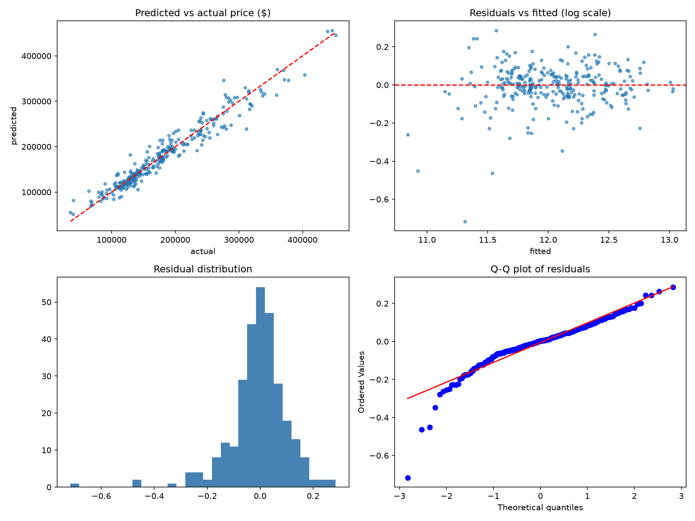
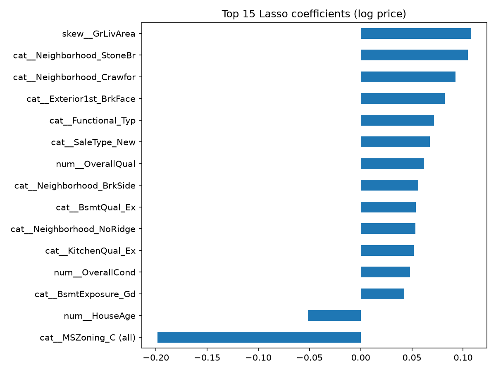

# House Price Prediction: Regularised Regression and Residual Analysis

## Question
Can we predict house sale prices in Ames, Iowa from property features, and where does the model fail?

## Data
Ames Housing (Kaggle "House Prices: Advanced Regression Techniques"), 1,460 sales and 80 features. Two extreme outliers (very large houses sold very cheaply) were removed, as recommended by the dataset author.

## Method
- Target: log(SalePrice), which reduces skew from 1.88 to 0.12 and makes errors relative
- Feature engineering: TotalSF, HouseAge, RemodAge, TotalBath, PorchSF, and flags for garage, pool, fireplace and remodelling
- Pipeline: median imputation, log transform for skewed numeric features, scaling and one-hot encoding (all fitted inside each CV fold, so no leakage)
- Models: OLS baseline, Ridge, Lasso, tuned XGBoost, and a Lasso + XGBoost blend
- 5-fold CV on the training set, then a single evaluation on a held-out 20% test set
- Residual analysis: distribution, Q-Q plot, error by price band, largest errors

## Results
| Model | CV RMSE (log) | Test R2 | Test MAE | Test MAPE |
|---|---|---|---|---|
| OLS | 0.1374 | | | |
| Ridge | 0.1129 | 0.919 | $13,781 | 8.3% |
| Lasso | 0.1122 | 0.928 | $13,111 | 7.9% |
| XGBoost (tuned) | 0.1143 | 0.917 | $13,522 | 8.4% |
| **Lasso + XGBoost blend** | | **0.929** | **$12,547** | **7.7%** |
| Baseline (median price) | | | $57,100 | |

The blend cuts the average error by about 78% versus predicting the median price. Regularisation clearly beat plain OLS (0.1122 vs 0.1374), and linear models matched XGBoost on this small dataset.

## Residual analysis
- Mean residual is close to zero (-0.006), so the model is not biased.
- Residuals are heavy-tailed (skew -1.52, kurtosis 7.43): a few houses are badly mispredicted.
- Error is highest for the cheapest quarter of houses (MAPE 11.6% vs 6 to 7% elsewhere), and cheap houses are slightly over-predicted.
- The five largest errors are all low-priced homes (for example, a $40k house predicted at $82k). These are probably unusual sales (distressed or non-market) that the features cannot explain.

## What drives price (Lasso)
Living area, premium neighbourhoods (StoneBr, Crawford), overall quality and new construction raise the price. Commercial zoning, house age and proximity to railways or arterial roads lower it. Lasso kept 119 of 322 features.

## Limitations
- Only about 1,460 rows from one city and period, so results may not transfer elsewhere.
- Non-normal residuals mean normal-based prediction intervals would be unreliable (conformal prediction would be a better choice).
- Weakest on low-priced homes. The extreme cases should be investigated, not just deleted.

## Tech
Python, scikit-learn, XGBoost, SciPy, Pandas, Matplotlib

## How to run
    python -m pip install pandas numpy scipy scikit-learn xgboost matplotlib joblib
    python src/house_price_model.py

Put train.csv in data/raw/ first.
